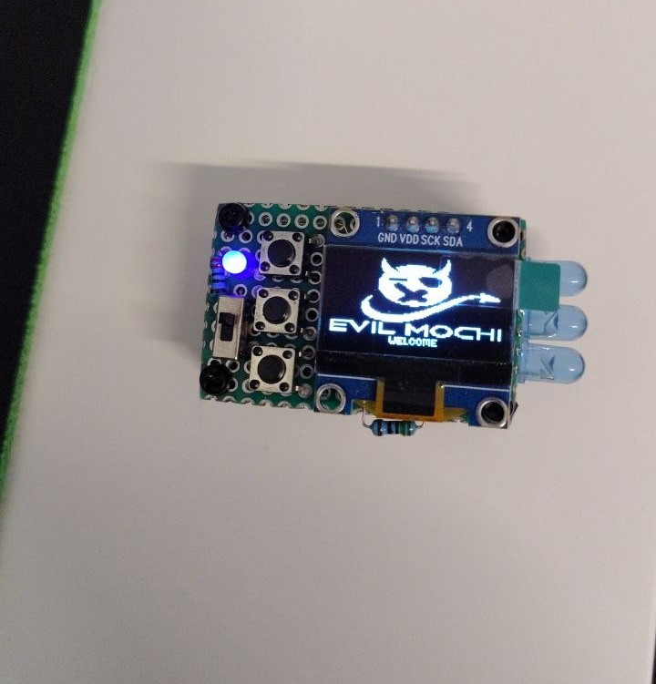
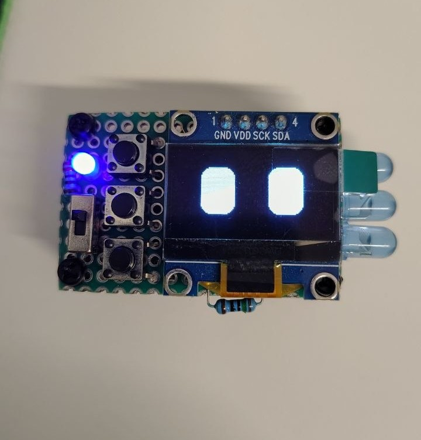
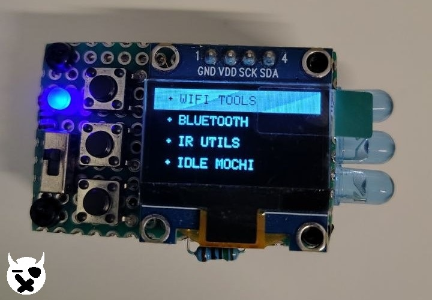
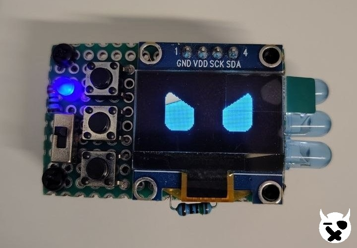

   
   

  

    
    
    
  

  

    
    
    
  

&nbsp;
<!-- About this Project -->
# ABOUT THIS PROJECT
Evil Mochi is a custom ESP32-C3 firmware designed for wireless tools, security testing, and general-purpose hardware utilities. It features Wi-Fi, Bluetooth, and IR functionality, alongside built-in games and a 128×64 I²C OLED display for an intuitive interface.

Combining offensive and defensive capabilities, Evil Mochi provides an accessible platform for enthusiasts, developers, and security researchers to explore wireless technologies, experiment with hardware, and test security configurations in controlled environments.

Beyond its technical features, Evil Mochi has a distinctive visual identity through its custom animated Mochi companion. When idle, Mochi displays expressive animations and changing moods, bringing personality to the interface and making the overall experience more engaging.

> [!NOTE]
> **Developed and tested on the ESP32-C3 SuperMini**, but works on any ESP32-C3 dev board with the same GPIO wiring.

&nbsp;

<table align="center">
  <tr>
    <td align="center" width="50%">
      
    </td>
    <td align="center" width="50%">
      
    </td>
  </tr>
  <tr>
    <td align="center" width="50%">
      
    </td>
    <td align="center" width="50%">
      
    </td>
  </tr>
</table>

&nbsp;

    
    
    
    

## 📌 Features & Functionality

<strong>📡 WIFI</strong>

  
| Tool | Description |
|------|-------------|
| Wi-Fi Scan | Full AP scan with SSID, BSSID, RSSI, and Channel |
| Deauth Attacks | Deauth Flood (targets all scanned APs) and Deauth Select (pick one target) |
| Captive Portal | Default "Free WiFi" portal and Evil Twin that logs captured credentials to the screen |
| Station Sniffer | Captures probe requests and data frames to see nearby phones/clients |
| Beacon Spam | floods the surrounding area with fake SSIDs |
| Packet Analyzer | Real-time live graph across all 16 channels |
| Guardian | Monitors for Wi-Fi attacks (Deauth floods, Beacon floods, Probe floods) and alerts you in real time |

<strong>🔵 BLUETOOTH</strong>

  
| Tool | Description |
|------|-------------|
| BLE Scan | Lists nearby BLE devices, names, and RSSI |
| Beacon Spam | Floods the surrounding area with fake Bluetooth SSIDs ( probably the most optimized for esp32c3 around ) |
| Android Spam | Broadcasts FastPair payloads displaying unwanted pairing requests or action modals |
| Bad BLE | 20 Highly optimized payloads for Android and Windows ( + you can change pairing beacon name as well ) |
| BLE Radar | Tracks nearby BLE devices and shows device name, MAC address, RSSI, visual proximity meter, and total times seen |

> **BLE Radar Distance**
> - **Nearby** → 0–3 m
> - **Moderate** → 3–8 m
> - **Very Far** → 10–30 m
> - **Extreme** → unkonwn 

<strong>📺 INFRARED</strong>

  
| Tool | Description |
|------|-------------|
| TVBGONE | Turn off any TV, Features 140 EU and 137 NA codes with a custom power icon fill animation |
> More coming soon                                                        

<strong>👾 IDLE MOCHI</strong>

  
| Tool | Description |
|------|-------------|
| Idle Mochi | Gets you back to mochi standby |
> **After 45-seconds its enters automatically to idle Mochi anyway**

> ***More features, styles and settings coming soon***

<strong>🕹️ GAMES</strong>

  
| Games | Description |
|------|-------------|
| Snake | (G)old school nokia game |
| Flappy | that stupid ass flying bird |
| Dino | classic chrome dino game (I tried my best) |
| CarJack | endless lane dodging game, gets faster the longer you drive |
| BBreaker | brick breaker game, pure arcade nostalgia |

<strong>⚙️ CONFIG</strong>

  
| Tool | Description |
|------|-------------|
| LED Status | Configure how bright you want your led indicator from 0 to 100% |
| Invert Colors | Inverts the colors displayed on the screen, turning each color into its opposite |
| Brightness | Adjusts how bright or dim your want your screen to appear |
| Temperature | Shows live the ESP's temperature in °C and °F |
| Restart | Restart the device if you can't reach the physical RST button |
| Wipe Data | Completely wipes data saved to NVS partition like settings,scores,etc |
> Everything is saved to NVS so its not lost after a reboot.

##### ⚠️ Some features may violate local laws. Use at your own risk.

## 🛠️ Hardware Required
- **ESP32-C3** – Main microcontroller with Wi-Fi and Bluetooth (Either C3 dev board or supermini will work)
- **DISPLAY** – 0.96" I2C OLED display 128x64 (SSD1306)
- **IR LED Trasmitter** – Either a generic IR trasmitter module or separate IR LEDs wired according to the schematic schematic below
- **STATUS LED + 1x150Ω resistor** – Any red,green,blue led will work properly
- **3x BUTTONS** – Any push button will do the job
- **Resistors 3x10Ω/1x150Ω** – (Optional, needed only if you are following my IR schematic)
- **transistors 1x NPN BJT** – (Optional, needed only if you are following my IR schematic)
>
> Battery Components (Not neccessarily unless you are following my IR diagram or you simply want it)
> 
- **Li Po 3.7V Battery** – Over 1k mAh if you dont want to change the resistor from the tp4056
- **SWITCH** – Any on/off switch will work
- **TP4056** – Make sure you get the charging module with battery protection which has 6 pads
- **MT3608** – DC-DC Step-Up (Boost) Converter
- **Alternatively, use a single module that integrates both as shown in my schematic below.**
> [!WARNING]
> If you are gonna charge a battery under 1000mAh please make sure to change the resistor with the appropiate value.

## 🔗 Connections Pinout      

> **Components Used:** ESP32C3SuperMini, OLED 0.96" Display 128x64 SSD1306, 3x Tactile Push Buttons, 3x TSAL6200 (IR LEDs), 5x Resistors (2x150Ω/3x10Ω), 1x 2n2222 Transistor, 1x On/Off Switch, 1x Status LED and a 3.7v Li Po Battery + TP4056+Booster module

### • DISPLAY
| Component | Pin |
| :--- | :--- |
| **VCC** | 3.3V | 
| **GND** | GND |  
| **SDA** | GPIO 8 |  
| **SCL** | GPIO 9 | 

### • Others 
| Component | Pin |
| :--- | :--- | 
| **IR LED** | GPIO 4 | 
| **Status LED** | GPIO 3 Through a 150Ω resistor |
| **Button UP** | GPIO 2 |     
| **Button OK** | GPIO 1 |  
| **Button DOWN** | GPIO 0 |  

### • Battery (Aditional) 
| Component | Connects to | 
| :--- | :--- | 
| **Battery (+)** | Switch / Leg 1 | 
| **Switch / Leg 2** | TP4056 BAT+ |
| **Battery (−)** | TP4056 BAT− |
| **TP4056 OUT+** | Booster IN+ |  
| **TP4056 OUT−** | Booster IN− |
| **Booster OUT+ (5V)** | ESP32 5V / VIN |
| **Booster OUT− (GND)** | ESP32 GND |

**Neccessary only if you are gonna follow my schematic.**

## 🚀 Installation & Flashing

### Via My Web Flasher (Easy)

<a href="https://evilmochiflasher.pages.dev" style="text-decoration: none; display: inline-block;">
  

    
  

</a>

I've created a webflasher to make it super easy for you to flash my firmware
- Visit [Evil-Mochi Flasher](https://evilmochiflasher.pages.dev) or click the **image**
- Press `Install Firmware` and flash it, thats all.
- Good luck, Have fun.

### Flashing via binary files..
- Download the firmware `.bin` file available on this repository
- Use any flasher of your choice
- Upload at 0x0 and flash

## 📩 Contact
- Portfolio: [nnmestore](https://nnmestore.pages.dev) 
- Tiktok:  [@nnme.dev](https://tiktok.com/@nnme.dev)
- Email:   nonametester@proton.me
 
## 🌟 Support 
- 💬 Found a bug or have a feature request? Open an [Issue](https://github.com/nnmeexplt/evil-mochi/issues)
- ⭐ Like the project? a star on the repo will make a big difference.
- 🤝 Want to see more projects like this? Drop a follow, it means a lot and keeps me motivated.

**Special thanks to the open-source pentesting community for protocol research and payload inspiration.**

> This project is intended for **educational and research purposes only.** Users are fully responsible for any misuse.
