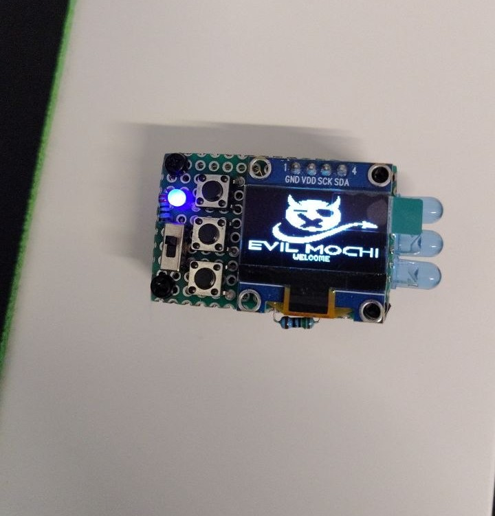
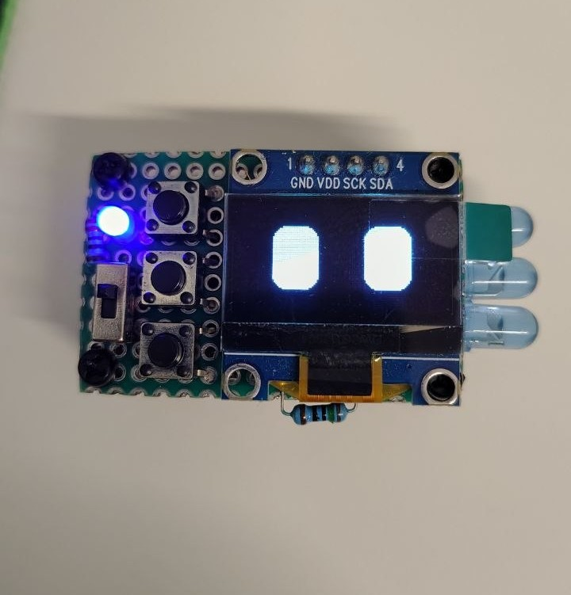
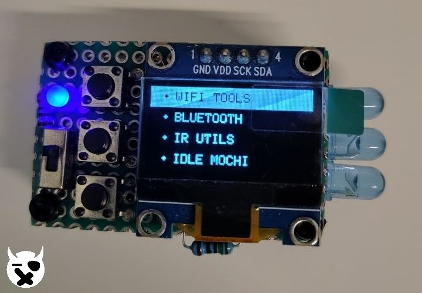
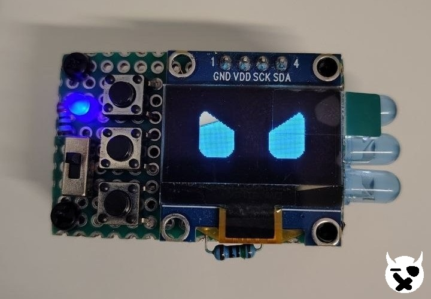

   
   

  

    
    
    
    
  

  

    
    
    
  

&nbsp;
<!-- About this Project -->
# ABOUT THIS PROJECT
Evil Mochi is a custom ESP32-C3 firmware made for wireless tools, pentesting, and general utilities. It supports Wi-Fi, Bluetooth, and IR functionality, with a 128×64 I²C OLED for the interface and a custom animated mochi that changes mood while on idle.

**Developed and tested on the ESP32-C3 SuperMini**, but works on any ESP32-C3 dev board with the same GPIO wiring.

> **some features may violate local laws.** Use at your own discretion and risk.

&nbsp;

&nbsp;

<table align="center">
  <tr>
    <td align="center" width="50%">
      
    </td>
    <td align="center" width="50%">
      
    </td>
  </tr>
  <tr>
    <td align="center" width="50%">
      
    </td>
    <td align="center" width="50%">
      
    </td>
  </tr>
</table>

&nbsp;

<!-- Features -->
## 📌 Features

<strong>📡 Wi-Fi</strong>

  
| Tool | Description |
|------|-------------|
| Wi-Fi Scan | Full AP scan with SSID, BSSID, RSSI, and Channel |
| Deauth Attacks | Deauth Flood (targets all scanned APs) and Deauth Select (pick one target) |
| Captive Portal | Default "Free WiFi" portal and Evil Twin that logs captured credentials to the screen |
| Station Sniffer | Captures probe requests and data frames to see nearby phones/clients |
| Beacon Spam | floods the surrounding area with fake SSIDs |
| Packet Analyzer | Real-time live graph across all 16 channels |
| Guardian | Monitors for Wi-Fi attacks (Deauth floods, Beacon floods, Probe floods) and alerts you in real time |

<strong>🔵 Bluetooth</strong>

  
| Tool | Description |
|------|-------------|
| BLE Scan | Lists nearby BLE devices, names, and RSSI. |
| Beacon Spam | Floods the surrounding area with fake Bluetooth SSIDs (probably the most optimized for esp32c3 around) |
| Android Spam | Broadcasts FastPair payloads with random MACs |
| Bad BLE | HID emulation for injecting keystrokes over Bluetooth Low Energy |
| BLE Radar | Tracks nearby BLE devices and shows device name, MAC address, RSSI, visual proximity meter, and total times seen |

<strong>📺 Infrared</strong>

  
| Tool | Description |
|------|-------------|
| TVBGONE | Turn off any TV, Features 140 EU and 137 NA codes with a custom power icon fill animation |
> More coming soon                                                        

<strong>👾 Idle Mochi</strong>

  
| Tool | Description |
|------|-------------|
| Idle Mochi | Gets you back to mochi standby |
> After 45-seconds its enters automatically to mochi standby 

<strong>⚙️ Config</strong>

  
| Tool | Description |
|------|-------------|
| LED Brightness | Configure how bright you want your led indicator from 0 to 100% |
| Invert Colors | Inverts the colors displayed on the screen, turning each color into its opposite |
| Restart | Restart the device if you can't reach the physical RST button |
> Brightness & Color Inversion its saved to NVS so its not lost after first restart or shut off

> [!WARNING]
> This project is intended for **educational and research purposes only**. Unauthorized use may violate local laws.
